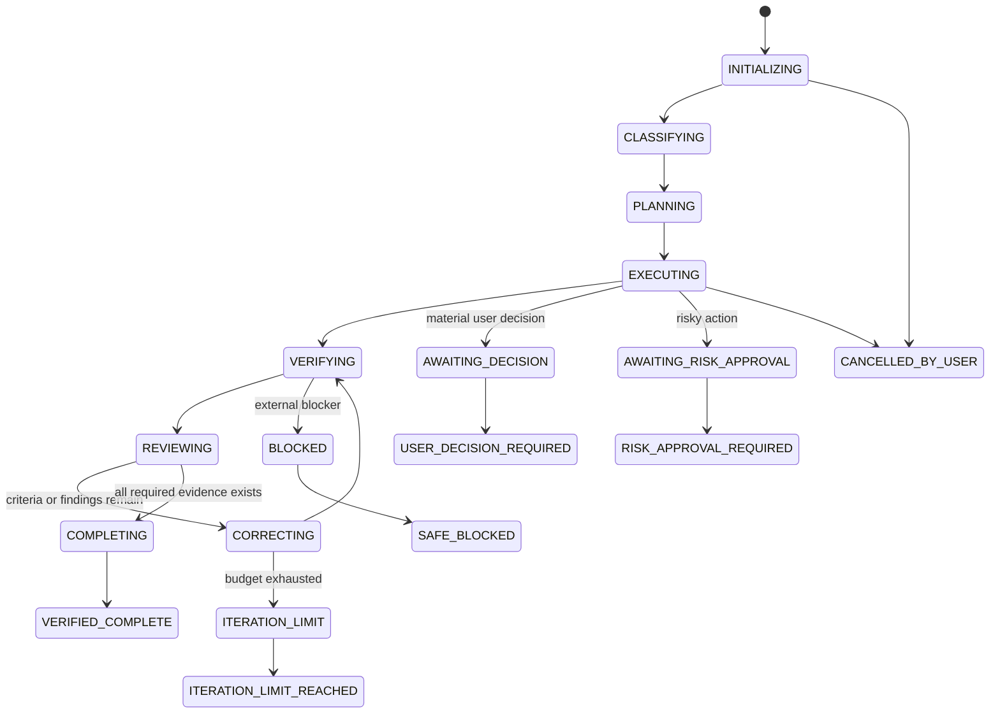

# Runtime State Machine

## States

## Run-state ownership

The deterministic runtime owns state transitions. The model proposes actions and reports evidence, but may not directly mark a run complete without satisfying the completion gate.

## Required run-state fields

- Schema version (currently `1.1.0`).
- KRYLO version.
- Host identity: host name, host session identifier, and optional host turn identifier.
- Delegation: whether the run is an external-worker delegation, its depth, and an optional parent run identifier.
- KRYLO-owned run identifier, independent of the host session identifier.
- Project root hash and repository metadata.
- Lane, risk, and complexity.
- Normalized goal.
- Acceptance criteria.
- Constraints and non-goals.
- Selected agents and configured models.
- Resolved models when available.
- Tool counters.
- Orbit budget and current cycle.
- Failure fingerprints.
- Findings and criterion status.
- Evidence references.
- Terminal state.
- Timestamps.

## Schema versioning and migration

Schema `1.1.0` introduced host-neutral identity. It replaced the prior flat `sessionId` field with a `host` object (`name`, `sessionId`, optional `turnId`) and added a `delegation` object (`externalWorker`, `depth`, optional `parentRunId`). Migration from schema `1.0.0` is deterministic and one-directional: the legacy `sessionId` becomes `host.sessionId` with `host.name` set to `claude` (the only host that produced `1.0.0` state), and `delegation` defaults to a non-delegated, depth-0 run. A document with any other prior schema version, or a `1.0.0` document missing `sessionId`, is refused rather than guessed and the original file is left untouched.

Migration to the current schema happens purely in memory, inside `loadState()`; `loadState()` never writes a *migrated* document to disk under any circumstance -- that is a narrower claim than "never writes at all" (see the corrupted-state case below, which is a real exception). `saveState()` is the only place a migration is actually committed: if the schema version currently on disk differs from the schema version being saved, the exact original on-disk bytes are backed up first (`state.pre-migration-<oldVersion>-<epoch>.json`), then the migrated-and-mutated state is written. If that backup write itself fails (disk full, permissions, ...), `saveState()` refuses the save entirely (`{ ok: false, error: 'backup-failed' }`) and leaves the original file completely untouched -- "no prior file existed" (a brand-new run, nothing to back up) and "the backup write failed" are deliberately distinct conditions, never conflated. Every real mutator already calls `saveState()` from inside the run's exclusive lock, so this backup-then-persist is exactly as serialized as any other state mutation; a bare unlocked read (`read-state.mjs`, statusline/doctor/stagnation readers, a Hook's initial active-run check) can migrate a document in memory for its own use but can never persist that migration.

Refused or corrupted state is never overwritten with a fabricated replacement. `loadState()` copies the original file (or, if the file itself was already missing, the raw bytes it tried to parse) to `state.corrupt-<epoch>.json` beside it, then returns `{ ok: false, error: 'corrupted', recovered: true, corruptPath }` so the caller can report the problem; it never initializes a fresh recovery state on the caller's behalf. This corrupt-state preservation write is the one real exception to "`loadState()` never writes a migrated document": it writes a *copy of the untrusted original*, never a migrated or fabricated replacement.

Corruption is a property of bytes that were actually read (`docs/adr/0045-transient-state-io-retry.md`). Only unparseable JSON and a schema-invalid document are `corrupted`. A file that could not be read at all -- a transient Windows sharing error (`EPERM`/`EBUSY`) that outlasted the bounded read retry, or any other fs failure -- is reported as `{ ok: false, error: 'unreadable', transient, code }` and is never copied aside, so a live run momentarily held open by another process is never reported or preserved as corrupt. For the same reason `saveState()` treats only an absent file (`ENOENT`) as "no prior file"; a present-but-unreadable one refuses the save with `state-unreadable`. The `cleanup.mjs` pointer sweep deletes an active-run pointer only on positive evidence that its run is over (a corrupt or empty pointer, or a missing, corrupt, or terminal run), and only if a fresh read just before the delete still names the same run; an unreadable pointer or state is never evidence.

"Could not read" is also not "no run". When a session's own pointer, or the state it leads to (with no session id, the state behind the newest pointer the ADR-0020 fallback picks), exists but cannot be read, run resolution reports the run as indeterminate (`run-state-unreadable`) rather than absent. Both risk gates deny on it with a retry message, a Codex `$krylo-run` re-invocation keeps the live run instead of replacing it, and the runtime CLIs report `run-state-unreadable` instead of `no-current-run`. Every other Hook keeps its inactive-run behavior. A session with no KRYLO pointer of its own is unaffected.

## Persistence

State is stored under a KRYLO-owned data root resolved by the active host adapter (`${CLAUDE_PLUGIN_DATA}` on the Claude Host) using atomic writes:

1. Write a temporary file.
2. Flush when supported.
3. Rename over the prior state.
4. Validate against the schema.

On Windows the rename in step 3 fails with `EPERM` while any other process holds the target open, and every Hook reads `state.json` lock-free at startup, so under parallel hook load this is routine rather than exceptional. The rename, and every state read, retries only `EPERM`/`EBUSY` against a wall-clock deadline with jittered exponential backoff (1000ms for the rename, 250ms for a read); any other error fails immediately (`docs/adr/0045-transient-state-io-retry.md`).

Corrupted or schema-invalid state must not be trusted. KRYLO preserves the original file as `state.corrupt-<epoch>.json` for diagnosis and reports the problem; it does not initialize a fresh state on its own.

## Resumption

A resumed run must verify:

- The project root is unchanged.
- The current repository is compatible with the saved run.
- The current HEAD and working tree have not diverged in a way that invalidates the plan.
- Background agents are not assumed active after process restart.
- Evidence from prior commands is marked stale when the repository changed.
